# Qt WeChat Clone — Project Architecture

> A cross-platform instant-messaging (IM) system built with C++ / Qt. The backend is a
> distributed microservice architecture; the desktop client is a pixel-styled WeChat clone.
> Features: registration/login, friend management, text messaging, long-connection heartbeat,
> and offline handling. A Chinese version of this document is kept alongside it in
> `WeChat项目架构文档.md`.

---

## 1. High-Level Architecture

The system splits into a **client** and a **server**. The server is four independent processes
that cooperate over gRPC and talk to Redis / MySQL:

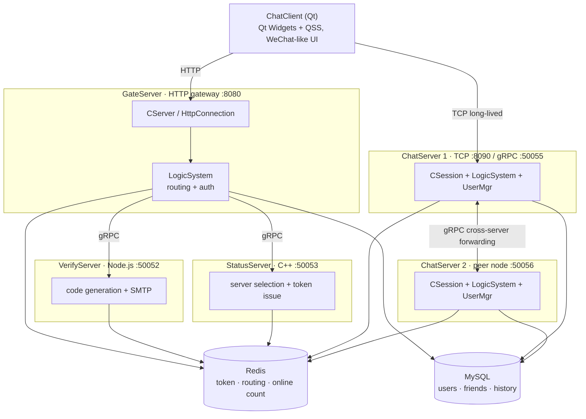

**Core design ideas**

- **Access vs. business separation**: GateServer only does HTTP ingress and stateless business
  (register / login auth); it holds no long connections. ChatServer owns the high-concurrency
  TCP long connections and message routing.
- **State centralized, services stateless**: login state (token, uid→server map, uid→session map)
  lives entirely in Redis, so any ChatServer can locate a user's node through Redis.
- **gRPC for service-to-service calls**: C++ services communicate over protobuf + gRPC; message
  delivery across ChatServers also uses gRPC, enabling horizontal scaling.
- **Connection pooling**: Redis, MySQL and gRPC stubs are all pooled and kept alive by background
  threads to avoid repeated connects.

---

## 2. Tech Stack

| Layer | Technology |
|-------|------------|
| Client UI | C++, Qt Widgets, QSS, QPainter, custom bubble widgets |
| Client network | QtNetwork (QNetworkAccessManager for HTTP, QTcpSocket for long conn) |
| Server network | Boost.Asio, Boost.Beast (HTTP), epoll |
| Inter-service | gRPC + Protocol Buffers |
| Serialization | JSON (client↔ChatServer, inside GateServer), protobuf (between services) |
| Cache / storage | Redis (hiredis / ioredis), MySQL (MySQL Connector/C++) |
| Helper libs | jsoncpp, boost::property_tree (ini parsing), nodemailer |
| Runtime | Linux (servers), cross-platform (client) |

---

## 3. Server Modules

### 3.1 GateServer — HTTP ingress gateway (C++)

**Role**: the single HTTP entry point for the client; handles registration, login, password reset
and verify-code requests.

- **Entry**: `GateServer/GateServer.cpp:125`. Reads `[GateServer] Port` (default 8080), creates a
  `CServer` listener, and installs SIGINT/SIGTERM graceful shutdown.
- **HTTP layer**: `HttpConnection.cpp`, async read/write over Boost.Beast. Supports GET (query
  params) and POST (body). Has a `deadline_` timer that closes idle connections after 60s.
- **Concurrency**: `AsioIOServicePool` round-robins new connections onto several `io_context`
  threads; the main `io_context` only accepts.
- **Routes** (`LogicSystem`, GET via `_get_handlers`, POST via `_post_handlers`):

  | Method | Path | Logic |
  |--------|------|-------|
  | GET | `/get_test` | connectivity test |
  | POST | `/get_verify_code` | forward to `VerifyGrpcClient` to email a code |
  | POST | `/user_register` | check Redis `code_<email>`, call `MysqlMgr::RegUser` |
  | POST | `/reset_pwd` | check code + `CheckEmail`, then `UpdatePwd` |
  | POST | `/user_login` | `CheckPwd` → `StatusGrpcClient::GetChatServer(uid)` → return host/port/token |

- **Downstream deps**: VerifyServer (gRPC 50052), StatusServer (gRPC 50053), MySQL, Redis.

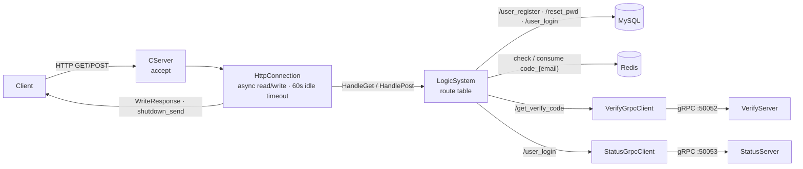

- **Config** `GateServer/config.ini`: `[GateServer] Port`, `[VerifyServer]`, `[StatusServer]`,
  `[Mysql]`, `[Redis]`.

### 3.2 StatusServer — status / scheduling (C++)

**Role**: login token issuance + ChatServer load-balanced selection.

- **Entry**: `StatusServer/StatusServer.cpp:16`, gRPC listens on configured `[StatusServer] Host:Port`
  (50053).
- **Service impl** `StatusServiceImpl.cpp`:
  - `GetChatServer(uid)`:
    1. read the Redis Hash `logincount` for each node's current online count, using the configured
       server list (`cfg["chatservers"]["Name"]`);
    2. pick the ChatServer with the **fewest** online users (treated as `INT_MAX` before first data);
    3. generate a UUID token, write Redis `utoken_<uid>`;
    4. return `host / port / token`.
  - `Login(uid, token)`: compares against Redis `utoken_<uid>`; used by ChatServer for a second check.

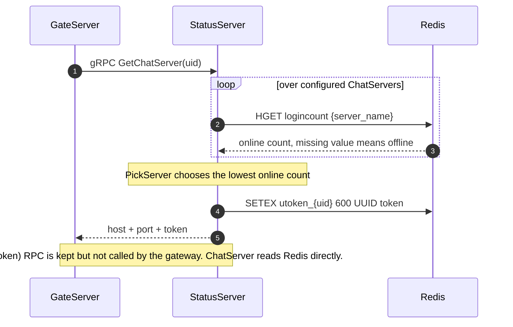

- **Config**: needs `[chatservers] Name = chatserver1,chatserver2` plus a section per node with
  Host/Port. A sample `StatusServer/config.ini` is included; adjust for the deployment.

### 3.3 VerifyServer — email verify-code service (Node.js)

**Role**: generate a code → store in Redis (600s TTL) → send via SMTP.

- **Entry**: `VerifyServer/server.js`, gRPC listening on `0.0.0.0:50052` (matches config.ini and the
  C++ side).
- **Logic**: validate the address (`verify.js`), claim a per-email 60s resend slot with `SET NX EX`,
  reuse `code_<email>` if it is still live (a resent mail repeats the same code), otherwise draw a
  6-digit zero-padded code and store it with a 600s TTL, then call `email.js` (nodemailer,
  `smtp.yeah.net:465`, TLS). A failed send or a lost Redis write releases the slot. GateServer treats
  the code as single-use and deletes it after a successful register/reset.

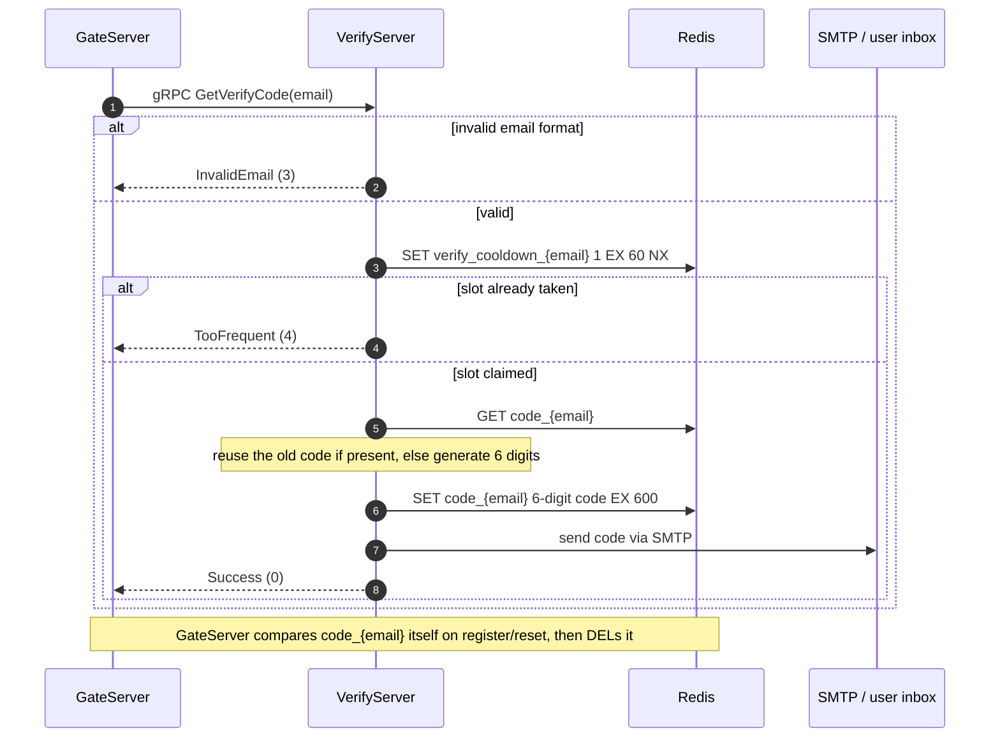

- **Error codes**: `InvalidEmail = 3` / `TooFrequent = 4` are passed straight through GateServer, so
  the client sees them as `error` values.
- **`redis.js`**: ioredis-based with a 10s heartbeat and its own reconnect, exposing
  `GetRedis / QueryRedis / SetRedisExpire / SetRedisNxExpire / DelRedis`.
- **Config** `VerifyServer/config.json`: `email.host/user/pass`, `redis.host/port/passwd`. The file is
  untracked and gitignored; copy `config.example.json` and fill it in.

### 3.4 ChatServer — long connections & messaging (C++, core)

**Role**: carries client TCP long connections; handles login, friend requests, message send/receive
and heartbeat; cross-node messages are forwarded over gRPC.

**Entry**: `ChatServer/ChatServer.cpp:78`

1. `ConfigMgr::Inst()` reads `[SelfServer]` (Name/Host/Port/RPCPort);
2. `RedisMgr` initializes and sets its own online count `logincount[Name]` to 0, cleaned up on exit
   via `Defer`;
3. start `CServer` (TCP, default 8090) and the heartbeat sweep timer;
4. start the gRPC server (`ChatServiceImpl`, default 50055) on a separate thread;
5. `LogicSystem` binds `CServer` and enters `io_context.run()`.

**Key classes**

| Class | File | Purpose |
|-------|------|---------|
| `CServer` | CServer.cpp/h | TCP acceptor, manages `_sessions` (session_id→session), 60s heartbeat sweep |
| `CSession` | CSession.cpp/h | one connection: async send/recv, frame parsing, send queue, heartbeat ts, cleanup |
| `LogicSystem` | LogicSystem.cpp/h | single-threaded message consume queue + msg-id → callback dispatch; business serialized under a lock |
| `UserMgr` | UserMgr.cpp/h | singleton, `uid → session` map for cross-session push |
| `ChatServiceImpl` | ChatServiceImpl.cpp/h | gRPC server: cross-node notify add-friend / auth / text msg / kick |
| `ChatGrpcClient` | ChatGrpcClient.cpp/h | gRPC client, maintains a stub pool keyed by target address |
| `AsioIOServicePool` | AsioIOServicePool.cpp/h | `io_context` thread pool, round-robin assignment |
| `RedisMgr` | RedisMgr.cpp/h | hiredis pool + 60s PING keepalive + distributed lock |
| `MysqlMgr` / `MysqlDao` | MysqlMgr/MysqlDao | MySQL pool (60s `SELECT 1` keepalive) + user/friend/chat-history DAO |
| `DistLock` | DistLock.cpp/h | Redis-based distributed lock (setnx + expire + unique token) |

**Business callbacks (`LogicSystem::RegisterCallBacks`, LogicSystem.cpp:90)**

| Msg ID | Constant | Handler | Notes |
|--------|----------|---------|-------|
| 1005 | `MSG_CHAT_LOGIN` | `LoginHandler` | token check, load user + friend/apply lists, bind session, kick old |
| 1007 | `ID_SEARCH_USER_REQ` | `SearchInfo` | search by uid (numeric) or username |
| 1009 | `ID_ADD_FRIEND_REQ` | `AddFriendApply` | write apply, locate peer server, notify |
| 1013 | `ID_AUTH_FRIEND_REQ` | `AuthFriendApply` | accept friend, write bidirectional relation, notify |
| 1017 | `ID_TEXT_CHAT_MSG_REQ` | `DealChatTextMsg` | persist first (`INSERT IGNORE`, idempotent), then check online and forward |
| 1023 | `ID_HEART_BEAT_REQ` | `HeartBeatHandler` | reply to heartbeat |
| 1028 | `ID_GET_CHAT_HISTORY_REQ` | `DealGetChatHistory` | newest history page, then upward paging by `last_id` (≤50 per page) |

**Message routing core**: for any message, look up the target's ChatServer via Redis `uip_<touid>`.
If it equals the local name, push directly through `UserMgr`'s session; otherwise call
`ChatGrpcClient` to forward over gRPC, where the peer `ChatServiceImpl` drops it into its local
session.

**Heartbeat & offline**: every 60s sweep all sessions; `_last_heartbeat` older than 300s is expired →
`Close()` → `DealExceptionSesseion()`. The latter is guarded by the **distributed lock** `lock_<uid>`,
verifies Redis `usession_<uid>` still equals this session (to avoid deleting a newly logged-in
session), then clears `usession_`/`uip_` and removes the session.

---

## 4. Client Modules (ChatClient)

### 4.1 Entry & window flow

`main.cpp` loads the QSS stylesheet, reads `config.ini` to build `gate_url_prefix`, and constructs
`MainWindow`. `MainWindow` switches its central widget as a state machine:

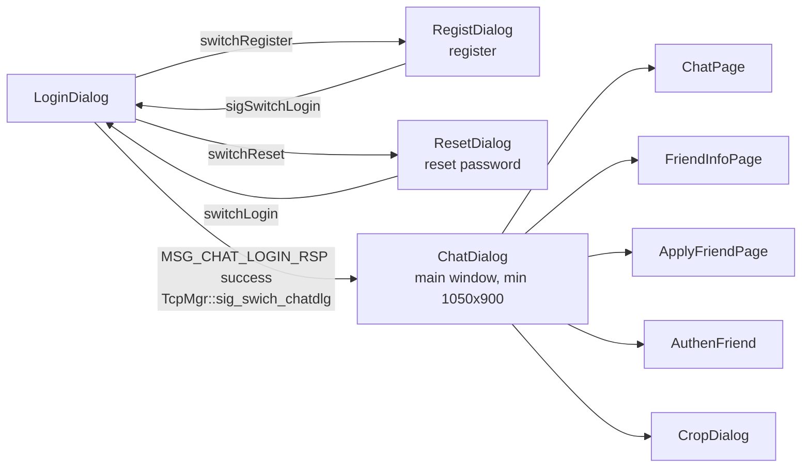

`ChatDialog` is the post-login IM shell (chat list / contacts / search / chat page / heartbeat).

### 4.2 Network layer

- **HTTP (`httpmgr.cpp`)**: `QNetworkAccessManager` async JSON POST; emits `sig_http_finish`, routed
  by module to register/reset/login signals. Endpoints: `/get_verify_code`, `/user_register`,
  `/reset_pwd`, `/user_login`.
- **TCP long conn (`tcpmgr.cpp`)**:
  - **Frame**: 4-byte header = 2-byte msg id + 2-byte length (big-endian), followed by a JSON body;
    sent/received with `QDataStream`, partial packets buffered in `_b_recv_pending`.
  - **Dispatch**: `_handlers` maps msg id → slot (`HandleMsg`).
  - **Heartbeat**: `ChatDialog` sends `ID_HEART_BEAT_REQ` every 10s.
  - **Disconnect**: no auto-reconnect; on `disconnected` it warns and forces back to login.
  - Connection params (Host/Port/Token/Uid) come from the login HTTP response.

### 4.3 Application state

`usermgr.cpp` (singleton) caches `_user_info`, `_apply_list`, `_friend_list`, `_friend_map`,
`_token`, and provides paginated chat/contact lists (`CHAT_COUNT_PER_PAGE`). `userdata.h` defines
plain data structs: `SearchInfo`, `AddFriendApply`, `ApplyInfo`, `AuthInfo`, `FriendInfo`,
`UserInfo`, `TextChatMsg`, etc.

### 4.4 Main UI classes

| Class | Purpose |
|-------|---------|
| `LoginDialog` | login form; triggers TCP connect on success |
| `RegistDialog` | email-code registration (with countdown) |
| `ResetDialog` | password reset via code |
| `ChatDialog` | IM shell hosting chat/contacts/search/heartbeat |
| `ChatPage` | one friend's chat page (history + input) |
| `FileTransferMgr` / `FileBubble` | chunked file send/receive (16-chunk send window, 30s watchdog) and transfer bubbles |
| `CropDialog` | square crop dialog after picking an avatar from the sidebar (saved locally per uid, not uploaded) |
| `ChatView` / `ChatUserWid` / `ChatUserList` | chat session list and scroll view |
| `ApplyFriend` / `AuthenFriend` / `ApplyFriendPage` | send request / handle request / request list |
| `FriendInfoPage` / `ContactUserList` / `ConUserItem` | friend detail, contact list |
| `SearchList` / `LoadingDlg` / `FindSuccessDlg` / `FindFailDlg` | search results, loading and result popups |
| `StateWidget` / `ClickedBtn` / `ClickedLabel` / `TimerBtn` / `FriendLabel` | custom styled widgets |

### 4.5 Message bubble rendering

- `BubbleFrame`: QPainter rounded rect + tail; green `(158,234,106)` for self, white for other.
- `ChatItemBase`: grid row (nickname + 42×42 avatar + bubble), mirrored by `ChatRole::Self/Other`.
- `TextBubble`: transparent read-only QTextEdit; `eventFilter` adjusts height/width dynamically.
- `PictureBubble`: scaled QLabel (max 160×90).
- `ChatView`: QScrollArea + QVBoxLayout; auto-scrolls to bottom when appending.

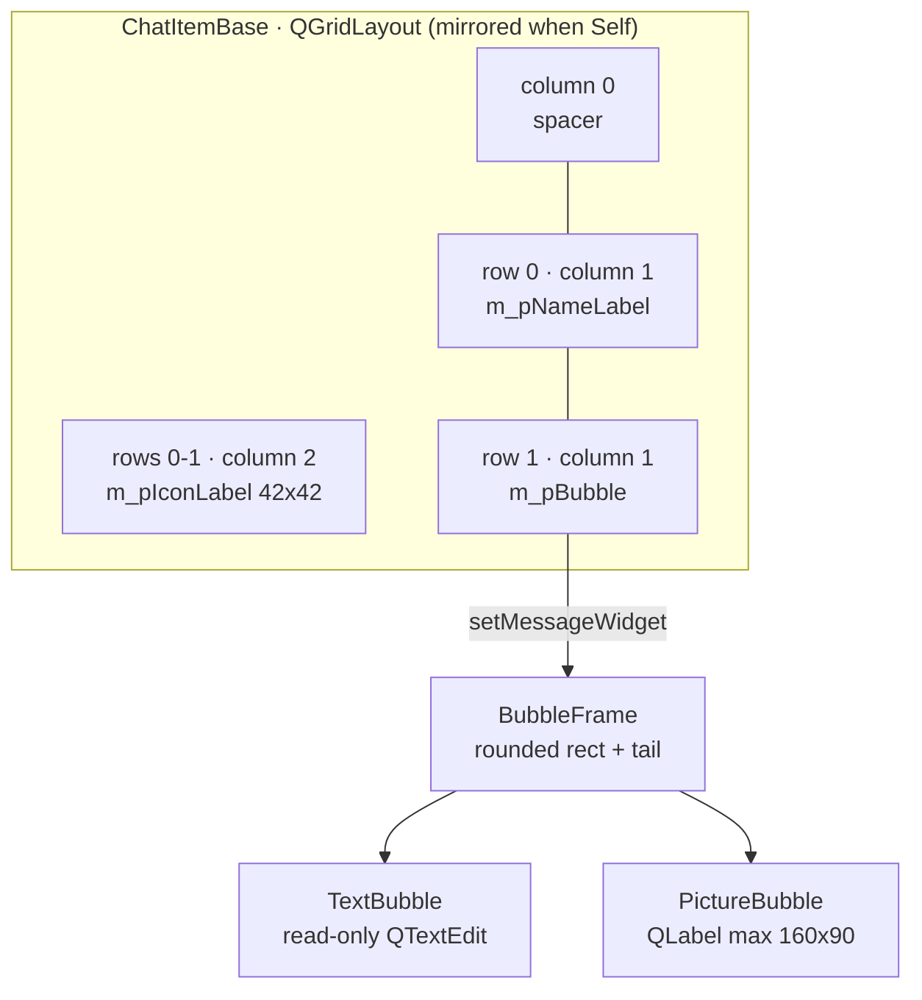

### 4.6 Project config

`Chat.pro`: `QT += core gui network widgets`, `CONFIG += c++11`, `RC_ICONS = icon.ico`, output to
`./bin`. Resources in `rc.qrc` (icons/images); external `config.ini` and `style/stylesheet.qss` are
copied into `bin` after build.

---

## 5. Protocols

### 5.1 Client ↔ ChatServer (custom TCP frame)

```
┌────────────┬────────────┬───────────────────────────┐
│ msg_id(2B) │ length(2B) │         body (JSON)        │
└────────────┴────────────┴───────────────────────────┘
        big-endian (network order), body max 2*1024 bytes
```

Send queue cap `MAX_SENDQUE = 1000`, receive queue cap `MAX_RECVQUE = 10000`.

### 5.2 Service-to-service (gRPC / protobuf)

`message.proto` (one copy each in ChatServer/GateServer/StatusServer, identical) defines three
services:

- `VerifyService.GetVerifyCode(GetVerifyReq) → GetVerifyRsp`
- `StatusService.GetChatServer / Login`
- `ChatService.NotifyAddFriend / RplyAddFriend / SendChatMsg / NotifyAuthFriend / NotifyTextChatMsg / NotifyKickUser`

### 5.3 Message ID constants (`ChatServer/const.h:77`)

| ID | Constant | Direction |
|----|----------|-----------|
| 1005 / 1006 | `MSG_CHAT_LOGIN` / `_RSP` | client login |
| 1007 / 1008 | `ID_SEARCH_USER_REQ` / `_RSP` | search user |
| 1009 / 1010 | `ID_ADD_FRIEND_REQ` / `_RSP` | add friend request |
| 1011 | `ID_NOTIFY_ADD_FRIEND_REQ` | notify incoming request |
| 1013 / 1014 | `ID_AUTH_FRIEND_REQ` / `_RSP` | accept friend |
| 1015 | `ID_NOTIFY_AUTH_FRIEND_REQ` | notify accepted |
| 1017 / 1018 | `ID_TEXT_CHAT_MSG_REQ` / `_RSP` | send text |
| 1019 | `ID_NOTIFY_TEXT_CHAT_MSG_REQ` | notify incoming text |
| 1021 | `ID_NOTIFY_OFF_LINE_REQ` | notify offline / kicked |
| 1023 / 1024 | `ID_HEART_BEAT_REQ` / `ID_HEARTBEAT_RSP` | heartbeat |

### 5.4 Error codes (`const.h`)

`0 success`, `1001 JSON parse fail`, `1002 RPC fail`, `1003 code expired`, `1004 code wrong`,
`1005 user exists`, `1006 wrong password`, `1007 email mismatch`, `1008 pwd update fail`,
`1009 password invalid`, `1010 token invalid`, `1011 uid invalid`.

### 5.5 Redis key conventions

| Key | Meaning |
|-----|---------|
| `utoken_<uid>` | login token (written by StatusServer, checked by ChatServer) |
| `uip_<uid>` | user's ChatServer name (message routing) |
| `usession_<uid>` | user's current session id (prevents wrong-session cleanup) |
| `ubaseinfo_<uid>` | user base-info cache |
| `nameinfo_<name>` | name→info cache (search by name) |
| `logincount` (Hash) | online count per ChatServer (load balancing) |
| `code_<email>` | email verify code, TTL 600s, deleted once used |
| `verify_cooldown_<email>` | resend throttle, TTL 60s |
| `lock_<uid>` / `lockcount` | distributed lock and counter |
| `ipcount_` | defined but currently unused |

---

## 6. Key Flows

### 6.1 Registration

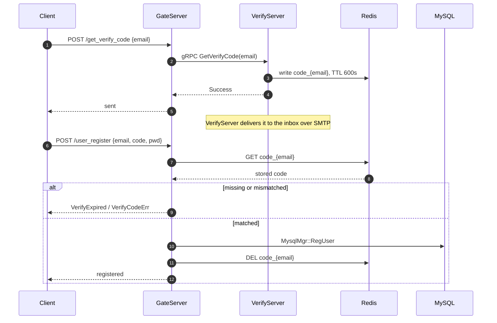

### 6.2 Login & connection (core path)

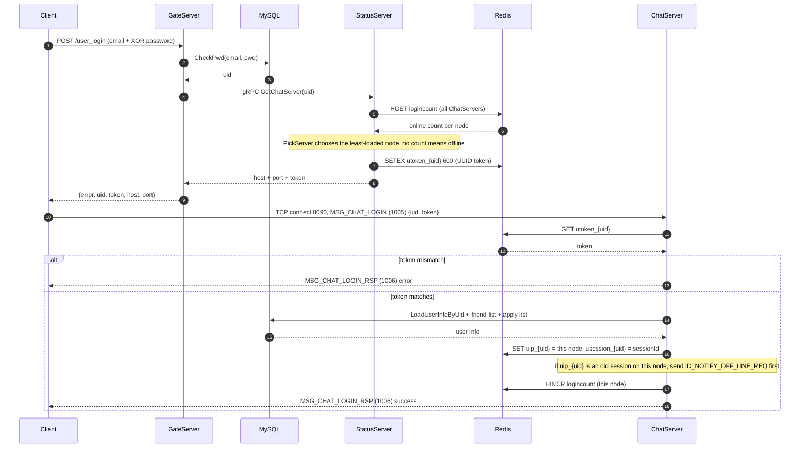

### 6.3 Adding a friend & accepting

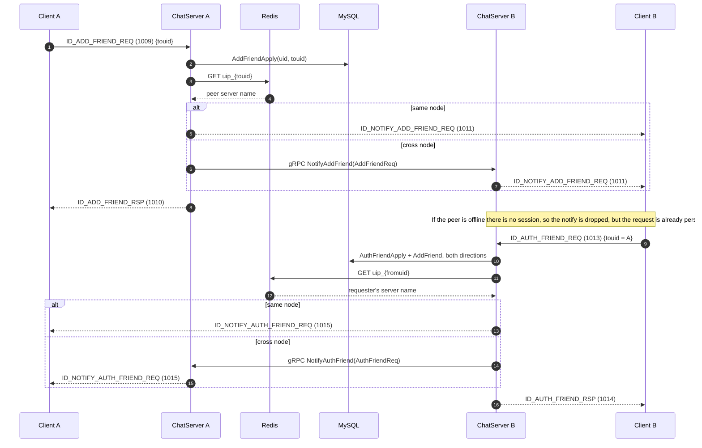

### 6.4 Sending a text message

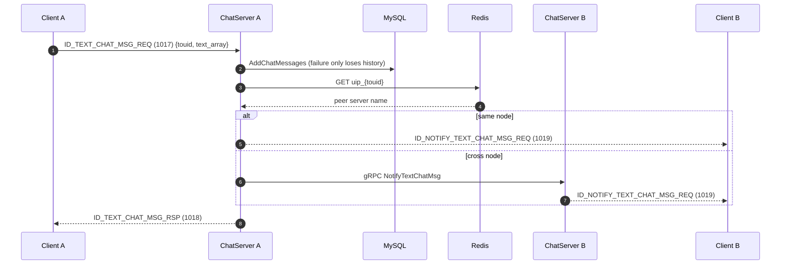

### 6.5 Heartbeat & offline

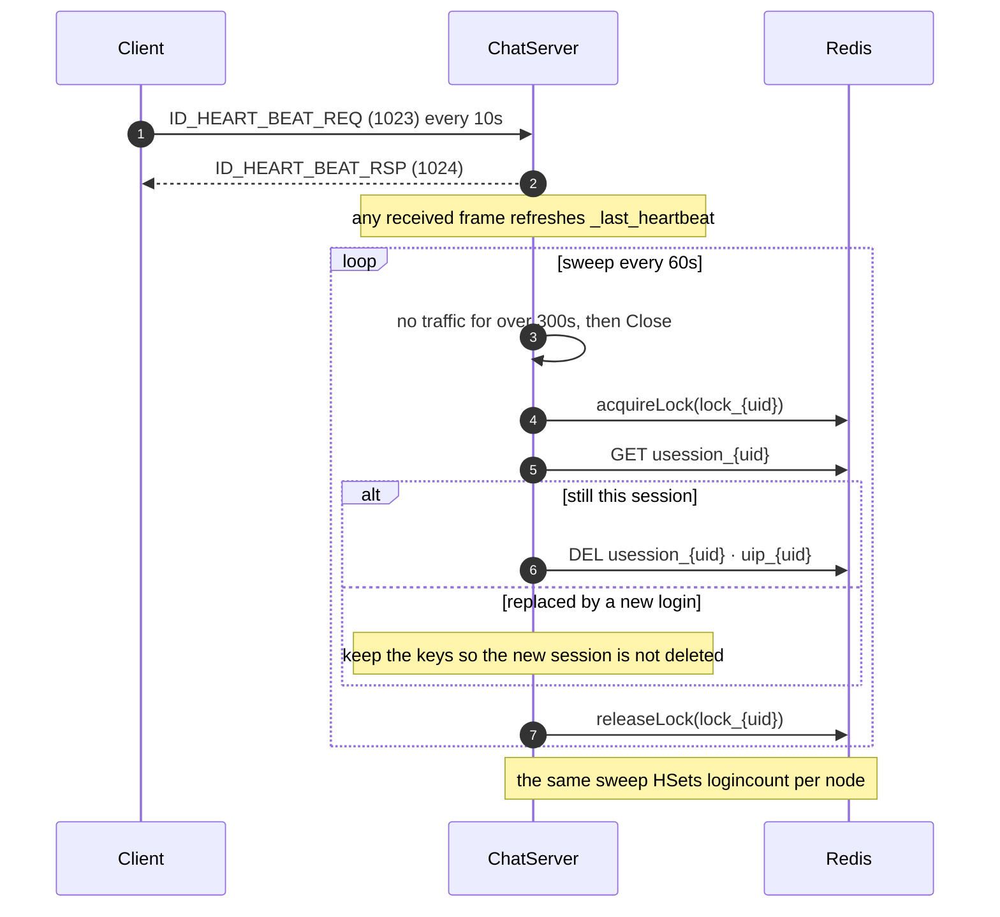

---

## 7. Concurrency Model Summary

- **Ingress**: `AsioIOServicePool` multiple `io_context` threads for socket I/O; single-threaded acceptor.
- **Business**: `LogicSystem` consumes the message queue on a single worker thread, serializing
  business logic naturally and avoiding heavy locking.
- **Cross-node**: gRPC thread pool + stub connection pool.
- **Shared state**: `UserMgr` and `CServer::_sessions` are locked; cross-node state converges in
  Redis, with a distributed lock guaranteeing kick/cleanup consistency.
- **Keepalive**: Redis PING 60s, MySQL `SELECT 1` 60s, HTTP idle timeout 60s, app heartbeat sweep 60s.

---

## 8. Ports & Config Summary

| Service | Protocol | Port | Config file |
|---------|----------|------|-------------|
| GateServer | HTTP | 8080 | `GateServer/config.ini` |
| VerifyServer | gRPC | 50052 | `VerifyServer/config.json` |
| StatusServer | gRPC | 50053 | `StatusServer/config.ini` |
| ChatServer | TCP | 8090 | `ChatServer/config.ini` |
| ChatServer | gRPC | 50055 | same |
| ChatServer2 (peer) | gRPC | 50056 | same |
| MySQL | TCP | 3306 | each service config |
| Redis | TCP | 6380 | each service config |

---

## 9. Build & Run

### 9.1 Toolchain versions used

Verified working on **Ubuntu 24.04 (noble)** with:

| Tool / lib | Version | apt package |
|------------|---------|-------------|
| gcc / g++ | 13.3.0 | (system) |
| CMake | ≥ 3.16 required; 3.28.3 used | `cmake` |
| C++ standard | C++17 | — |
| protoc | 3.21.12 | `protobuf-compiler` |
| gRPC C++ plugin | 1.51.1 | `libgrpc++-dev`, `protobuf-compiler-grpc` |
| protobuf dev | 3.21.12 | `libprotobuf-dev` |
| Boost | 1.83.0 | `libboost-all-dev` |
| jsoncpp | 1.9.5 | `libjsoncpp-dev` |
| hiredis | 1.2.0 | `libhiredis-dev` |
| MySQL Connector/C++ | 1.1.12 | `libmysqlcppconn-dev` |
| Node.js / npm | 20.20.2 / 10.8.2 | (VerifyServer) |
| Qt (client only) | 5.14+ or 6.x, Widgets + Network | `qtbase5-dev` / `qt6-base-dev` |

Install the backend dependencies:

```bash
sudo apt update
sudo apt install -y cmake build-essential pkg-config \
  libboost-all-dev libprotobuf-dev protobuf-compiler protobuf-compiler-grpc \
  libgrpc++-dev libjsoncpp-dev libhiredis-dev libmysqlcppconn-dev \
  default-libmysqlclient-dev
```

> On Debian/Ubuntu the MySQL headers live at `/usr/include/mysql_driver.h` and
> `/usr/include/cppconn/`, while the sources include them as `<jdbc/mysql_driver.h>`.
> The top-level `CMakeLists.txt` generates a `mysql_shim/jdbc/` symlink tree at configure
> time so no source changes are needed.

### 9.2 Build the three C++ services

```bash
cmake -S . -B build
cmake --build build -j4          # see memory note below
```

Outputs `build/GateServer`, `build/StatusServer`, `build/ChatServer`.
`protoc` + `grpc_cpp_plugin` regenerate `message.pb.*` / `message.grpc.pb.*` into
`build/gen/<service>/` on every build, so no generated protobuf files are committed.

> **Memory note**: each gRPC/protobuf translation unit is heavy. On a ~8 GB machine,
> `-j$(nproc)` can OOM-kill `cc1plus`; `-j4` is a safe value.

### 9.3 Build the Node.js VerifyServer

```bash
cd VerifyServer
npm install
node server.js                    # listens on 0.0.0.0:50052
```

### 9.4 Client (Qt)

The client is a qmake project: open `ChatClient/Chat.pro` in Qt Creator, or
`qmake && make` from a Qt kit shell. `Chat.pro` currently contains Windows-only post-link
steps (`copy` / `xcopy`) and an MSVC-only flag, so building on Linux/macOS requires trimming
those. The client build is **not verified in the Linux backend environment**.

### 9.5 Data stores

```bash
# MySQL schema (db01 + reg_user stored procedure)
mysql -uroot -p < sql/db01.sql

# Redis on 6380 with password 123456 (as the sample configs assume)
redis-server --port 6380 --requirepass 123456
```

### 9.6 Run the stack

Start in dependency order. Each C++ service reads `config.ini` **from its own working
directory**, so launch from inside the service directory:

```bash
(cd StatusServer && ../build/StatusServer)     # gRPC 50053
(cd ChatServer   && ../build/ChatServer)       # TCP 8090 + gRPC 50055
(cd GateServer   && ../build/GateServer)       # HTTP 8080
```

### 9.7 Smoke test

```bash
# 1. HTTP connectivity
curl "http://127.0.0.1:8080/get_test?foo=bar"

# 2. Register. /get_verify_code sends a real email, so for a local test inject the code
#    into Redis directly instead:
redis-cli -p 6380 -a 123456 SET "code_me@example.com" 123456 EX 300
curl -X POST http://127.0.0.1:8080/user_register -H 'Content-Type: application/json' \
  -d '{"user":"me","email":"me@example.com","passwd":"123456","confirm":"123456","verifycode":"123456","icon":""}'

# 3. Login (keyed on email) — returns token + target ChatServer host/port
curl -X POST http://127.0.0.1:8080/user_login -H 'Content-Type: application/json' \
  -d '{"email":"me@example.com","passwd":"123456"}'
```

A successful login returns `{"error":0,"uid":..,"token":"..","host":"127.0.0.1","port":"8090"}`,
proving the GateServer → MySQL → StatusServer(gRPC) → Redis chain works.

---

## 10. Fixed Issues & Remaining Notes

### 10.1 Fixed (branch `dev_xh`)

1. **`GateServer/LogicSystem.cpp` wrong content** — the file was actually a copy of ChatServer's TCP
   LogicSystem, incompatible with the HTTP route interface declared in `LogicSystem.h` and did not
   compile. Restored the correct HTTP implementation from commit `e434a92`.
2. **VerifyServer service name typo** — proto service was `VarifyService.GetVarifyCode`, mismatching
   the C++ `VerifyService.GetVerifyCode`. Renamed proto + `server.js` to `VerifyService.GetVerifyCode`.
3. **VerifyServer listen port** — bound 50051; changed to 50052 to match config.
4. **StatusServer missing config** — added `StatusServer/config.ini`.
5. **ChatServer missing `ConfigMgr.cpp`** — added it (link error) and fixed `operator=` missing
   `return *this;`.
6. **No build system** — added top-level `CMakeLists.txt` building the three C++ services.
7. **Missing includes / returns** — added `<thread>` / `<chrono>` for the Redis pool keepalive;
   fixed `-Wreturn-type` warnings in `CheckEmail` (three services) and `ChatGrpcClient::GetBaseInfo`.
8. **Session-removal race** — `RmvUserSession` now takes the session id and only erases the uid
   mapping when it still points at that session, so a late disconnect from a replaced connection
   cannot evict the live one.

### 10.2 Remaining notes

- **Hard-coded secrets**: `VerifyServer/config.json` is now untracked and gitignored, with
  `config.example.json` as the template — but its old values are still recoverable from git history
  and the leaked credentials still need rotating. `ChatServer/config.ini` etc. contain plaintext
  local-dev Redis passwords. Move to environment variables or placeholders before committing/deploying.
- **No client auto-reconnect**: on disconnect it returns straight to login; no exponential backoff.
- **`ipcount_`** is defined in `const.h` but never used — likely legacy.
- **Console output encoding**: GBK-commented sources print garbled Chinese in a UTF-8 terminal.

---

## 11. Directory Overview

```
WeChat/
├── ChatClient/      Qt client (UI / bubble widgets / TCP+HTTP network / style resources)
├── GateServer/      HTTP gateway (register/login/pwd, Boost.Beast)
├── StatusServer/    status & scheduling (token issuance, load-balanced selection)
├── VerifyServer/    Node.js email verify-code service
├── ChatServer/      long-connection & messaging service (TCP + gRPC + Redis/MySQL)
├── sql/db01.sql     MySQL schema + reg_user stored procedure
├── CMakeLists.txt   backend build script (three C++ services)
├── README.md
├── WeChat项目架构文档.md          Chinese architecture document
└── WeChat_Project_Architecture.md (this document)
```

The complete diagram set lives in [`docs/diagrams.md`](docs/diagrams.md) (Mermaid, rendered natively
by GitHub/GitLab/VS Code preview). The legacy `.drawio` files in each service directory have been
replaced by that document and removed.

---

## 12. Tutorial Progress (gitbookcpp.llfc.club day01–day45)

The project is implemented lesson by lesson. Current progress reaches **day37**, with day31
(file transfer), day32 (distributed lock) and day41 (Qt packet reassembly) also done early. day30
is interview-only, no code.

`[x]` done / `[ ]` not done:

```
[x] day01-05  framework / singleton & http mgr / boost setup / beast http / post+json → GateServer
[x] day06-07  grpc build & configure                                    → message.proto + gRPC
[x] day08-10  node email auth / redis / multi-service code dispatch     → VerifyServer + Gate
[x] day11-13  register / register UI / reset UI                         → regist/reset dialog
[x] day14     login and status service                                  → StatusServer
[x] day15-17  client Tcp mgr / asio tcp server / login & client state   → tcpmgr + ChatServer
[x] day18-26  main chat UI / search / lists / scroll / bubbles / sidebar / friend apply → ChatDialog UI
[x] day27-29  distributed chat service / friend query·apply·auth·chat   → ChatGrpcClient cross-node
[x] day32     distributed lock                                         → DistLock
[x] day33-35  single-node kick / cross-node kick / heartbeat            → NotifyKickUser + HeartBeat
[x] day31     file transfer                                             → FileTransferMgr + ID_FILE_MSG_REQ/RSP
[x] day36     Qt avatar cropping                                        → CropDialog (saved locally per uid)
[x] day37     chat message persistence                                  → chat_message + ID_GET_CHAT_HISTORY_REQ/RSP
[ ] day38     resumable transfer
[ ] day39     multimedia messages (voice/video)
[ ] day40     distributed transaction deadlock analysis
[x] day41     Qt packet reassembly analysis                             → tcpmgr _b_recv_pending
[ ] day42     notify client to async-download chat images
[ ] day43     user loads chat resources
[ ] day44     WebRTC coturn service setup
[ ] day45     WebRTC signaling server for video calls
```

**Suggested next order**: `day38 resumable transfer` → `day39 multimedia` → `day40 distributed
transactions` → `day42-43 image async download / chat resources` → `day44-45 WebRTC audio/video`.

> The sender's ChatServer persists each message **before** forwarding, so an offline peer pulls
> it back when the conversation opens. Opening a chat loads the newest 50 rows; scrolling to the
> top walks further back using the oldest `last_id`, and the response carries `has_more`. Rows
> dedupe on `msg_id` and order by the auto-increment `id`.

---

## 13. Feature Verification & Mock Accounts (standard.txt item 6)

### 13.1 Mock accounts: bypassing real email verification

The registration path (`/get_verify_code` → email → `/user_register`) depends on a real mailbox and
cannot be closed locally. New `scripts/mock_accounts.sh` addresses this:

```bash
scripts/mock_accounts.sh [count]     # default 5, creates mock1..mock5
```

- Calls the `reg_user` stored procedure directly; idempotent (reuses existing accounts); password is
  always `123456`.
- Also writes `code_<email> = 1234` (EX 600) into Redis, so `/user_register` can be driven end-to-end
  with `verifycode=1234` without receiving an actual email.
- Currently seeded: mock1=uid2, mock2=uid5, mock3=uid6, mock4=uid7, mock5=uid8, mock6=uid9.

### 13.2 End-to-end verification

`scripts/tcp_e2e.py` (`uv run scripts/tcp_e2e.py`) drives the full protocol over raw TCP; requires the
stack running and mock accounts seeded:

| Step | Message ID | Assertion |
|------|-----------|-----------|
| TCP login | 1005/1006 | `error=0`, returned `name` correct |
| Search user by name | 1007/1008 | peer uid + name matched |
| Add-friend apply | 1009/1010 + notify 1011 | applicant `error=0`; peer gets `applyuid` |
| Friend auth | 1013/1014 + notify 1015 | approver `error=0`; applicant gets `fromuid` |
| Text chat | 1017/1018 + notify 1019 | sender `error=0`; peer gets `content` |

The script deliberately logs mock1 in first, then fetches mock2's rendezvous server, so the two land
on **different ChatServers** (prints `cross-node: True`) and the cross-node gRPC notify path is really
exercised. Result: **11/11 passed**.

### 13.3 Problems found and fixed during this verification

1. **Collation mismatch silently broke registration** — `db01.sql` created the DB with
   `COLLATE utf8mb4_unicode_ci` while InnoDB tables defaulted to `utf8mb4_0900_ai_ci`. The stored
   procedure's parameters inherit the DB collation, so `CALL reg_user(...)` failed with
   `ERROR 1267 Illegal mix of collations`; the `EXIT HANDLER` swallowed it and returned -1. Fix:
   dropped the DB-level `COLLATE` from `sql/db01.sql`, ran `ALTER DATABASE db01 COLLATE
   utf8mb4_0900_ai_ci`, and recreated `reg_user`. Register and login recovered immediately.

2. **Connection-pool transaction leak (autocommit never restored)** — `AddFriend` in
   `ChatServer/MysqlDao.cpp` and `RegUserTransaction` in `GateServer/MysqlDao.cpp` both call
   `setAutoCommit(false)` to start a transaction but never restore it before the connection goes back
   to the pool. The connection is returned by its `Defer` still in manual-commit mode; the next
   borrower then runs inside a stale open transaction and blocks on row locks — the symptom was an
   intermittent hang at the "friend auth" step of the TCP E2E test. Fix: restore `setAutoCommit(true)`
   (guarded) inside both `Defer` blocks before returning the connection.

3. **Load-balancing counter never updated (`logincount` only refreshed by the 60s timer)** —
   `RedisMgr::IncreaseCount/DecreaseCount` existed but were **called from nowhere in the project**;
   `logincount` was only written by the 60s reconcile timer with the actual live session count. For the
   first minute after startup every client reads count 0, so StatusServer's least-connections pick
   collapses to whichever node is first in its `unordered_map` — all clients pile onto one ChatServer
   and the cross-node gRPC path is never reached. Fix: call `IncreaseCount` on successful login in
   `LogicSystem::LoginHandler`, and `DecreaseCount` for a logged-in session in `CServer::ClearSession`
   (the timer keeps reconciling to the absolute value). After the fix the two E2E users split across
   8090/8091 and `cross-node: True`.

4. **Redis not managed by the start scripts** — Redis (:6380) is a hard dependency of both
   ChatServer and VerifyServer, yet nothing started it. Without it the stack came up half-dead:
   ChatServer blocked on connect, VerifyServer crashed on startup, and only Gate+Status survived.
   Fix: `start_all.sh` probes :6380 and launches a local instance if nothing answers (port/password
   taken from the configs); `stop_all.sh` shuts it down too.

5. **Acceptor hit `Address already in use` on restart** — the `CServer` of ChatServer/GateServer
   bound the port directly in the constructor initializer list, leaving no chance to set
   `SO_REUSEADDR`. On a quick restart the previous instance's lingering connections made the rebind
   fail (chatserver2 refused to start on :8091). Fix: open, set the reuse option, bind and listen
   explicitly.

### 13.4 Commands that need sudo (not run here — run manually)

```bash
# Install DBeaver (GUI client for MySQL/Redis; .deb downloaded to /tmp/dbeaver-ce.deb)
sudo apt install -y /tmp/dbeaver-ce.deb

# If system libraries are missing (Qt6 runtime/build, Boost, hiredis, mysql-client, etc., per errors)
sudo apt install -y libboost-all-dev libhiredis-dev default-libmysqlclient-dev \
                    mysql-client redis-tools qt6-base-dev qt6-base-dev-tools
```

### 13.5 Qt UI polish: reusable frameworks / themes

The UI is Qt Widgets + QSS (`ChatClient/resource/stylesheet.qss`), so theming is a QSS swap rather
than a widget rewrite. Options:

- **QDarkStyleSheet** (easiest): a mature dark theme for Qt Widgets — `pip install qdarkstyle`, or
  just take its `style.qss`; one line `app.setStyleSheet(qdarkstyle.load_stylesheet())` reskins the
  app and stays fully compatible with this project's QSS mechanism.
- **Qt-Material**: Material Design theme (`qt-material`), light/dark plus accent colors, also for Qt
  Widgets.
- **QFluentWidgets / ElaWidgetTools**: modern Win11/Mica-style component libraries — best look but
  require re-basing some widgets, the largest change.
- **Hand-edit QSS**: recolor/round/spacing on the existing `stylesheet.qss`, zero dependencies, fine
  for visual tweaks only.

**Editing**: `.ui` files are plain XML — edit them in any WSL editor or in Qt Creator's Design mode;
the two are equivalent and Design mode is only a visual preview. QSS can be edited anywhere; after
editing, launch the client via `./scripts/start_client.sh` to see it (WSLg shows the window directly).
**Recommendation**: start with QDarkStyleSheet for a quick reskin, then tweak QSS locally as needed.
