# 架构与流程图（Mermaid）

本文件集中维护项目的架构图与关键流程图，取代各服务目录下原先的 `.drawio` 文件。所有图均为 Mermaid 文本，GitHub、GitLab、VS Code Markdown 预览可直接渲染，也可用 `npx @mermaid-js/mermaid-cli` 导出 SVG/PNG 用于汇报。

图中的消息 ID、Redis 键名与超时时间以代码为准；改动代码时请同步更新对应图块。

## 1. 总体架构

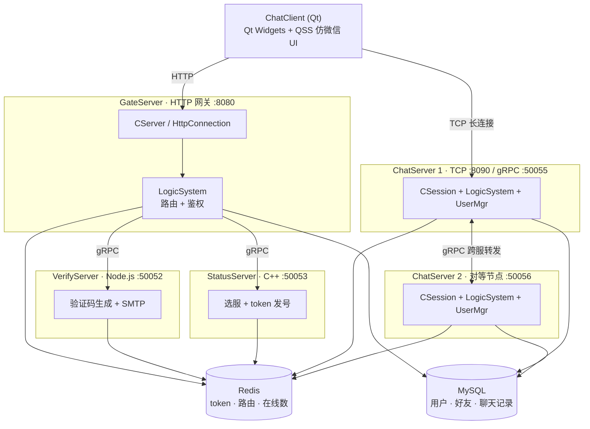

## 2. GateServer：HTTP 接入

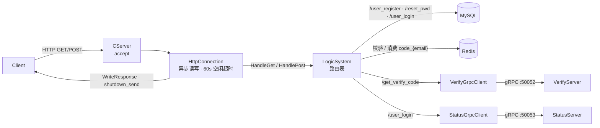

## 3. StatusServer：选服与发号

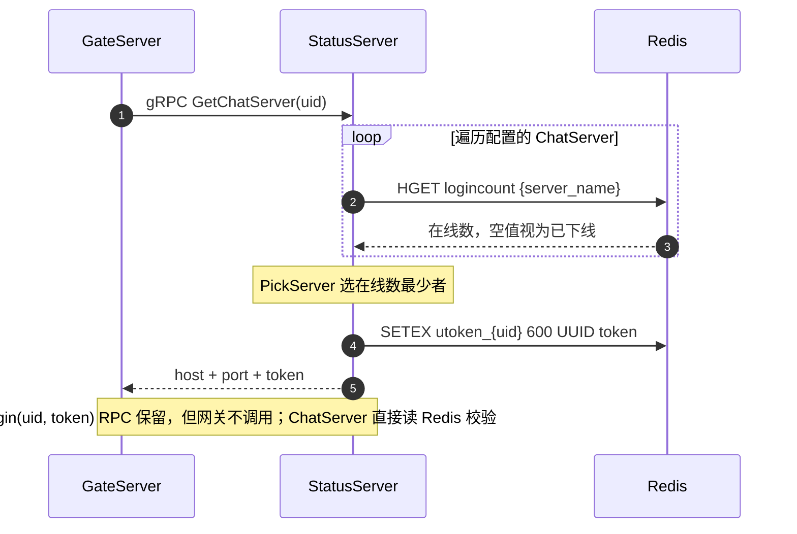

## 4. VerifyServer：验证码

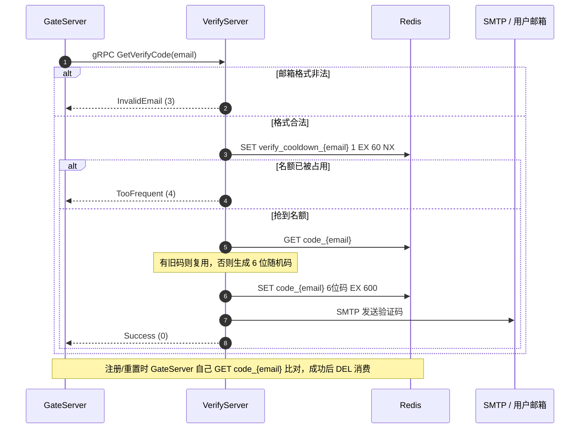

## 5. 客户端窗口流转

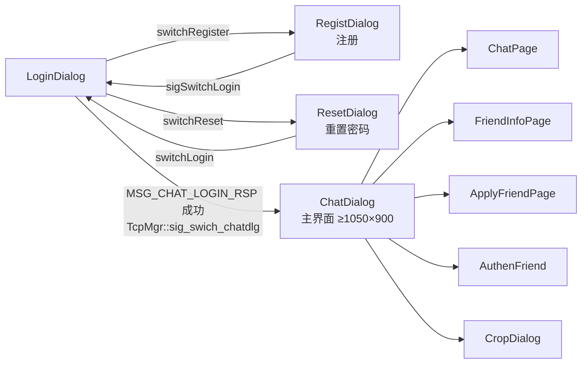

## 6. 消息气泡布局

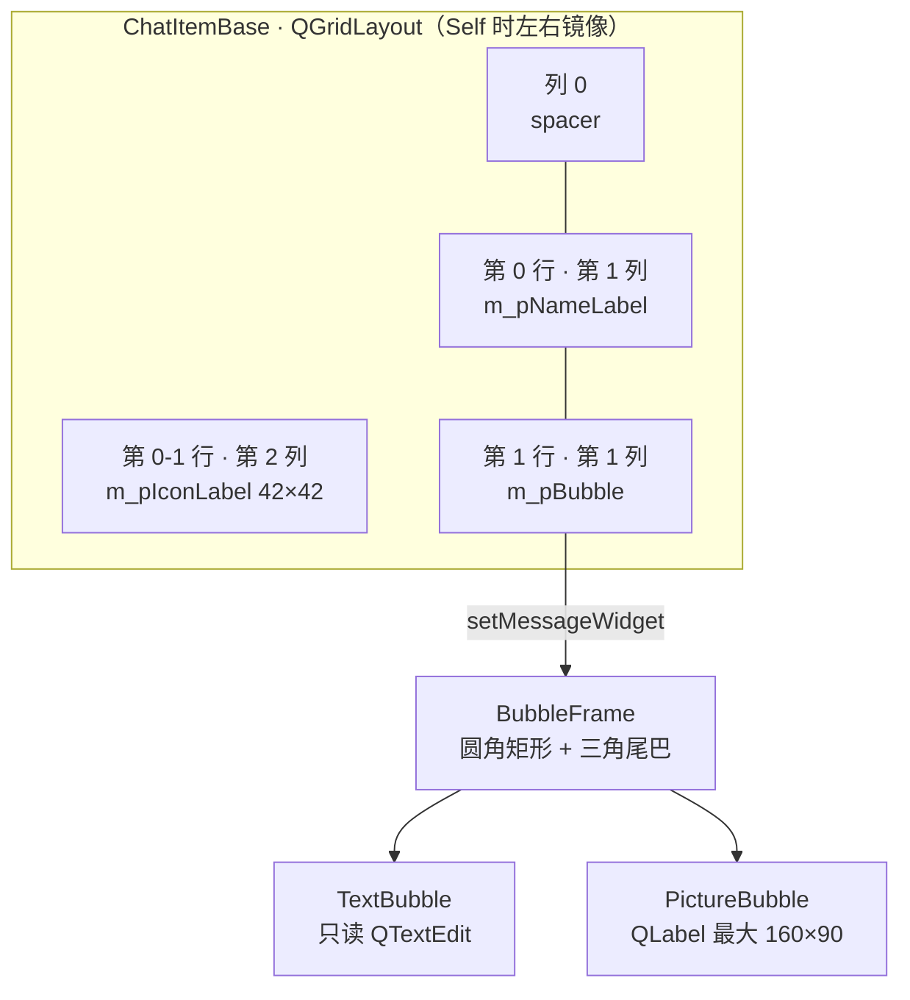

## 7. 登录与建连

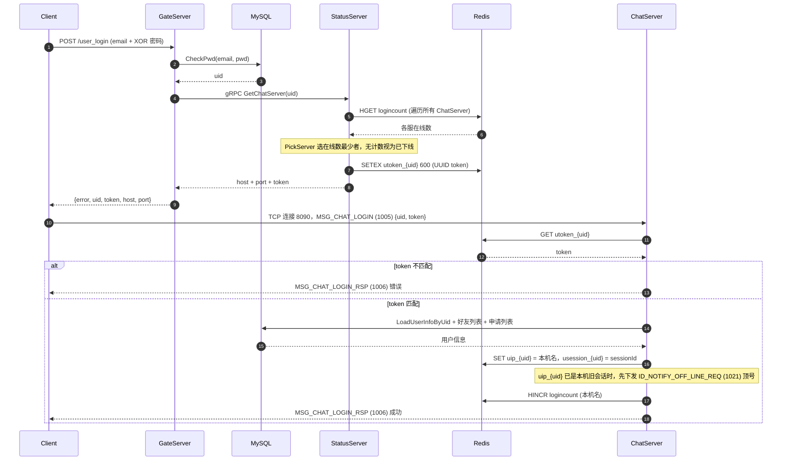

## 8. 加好友与通过验证

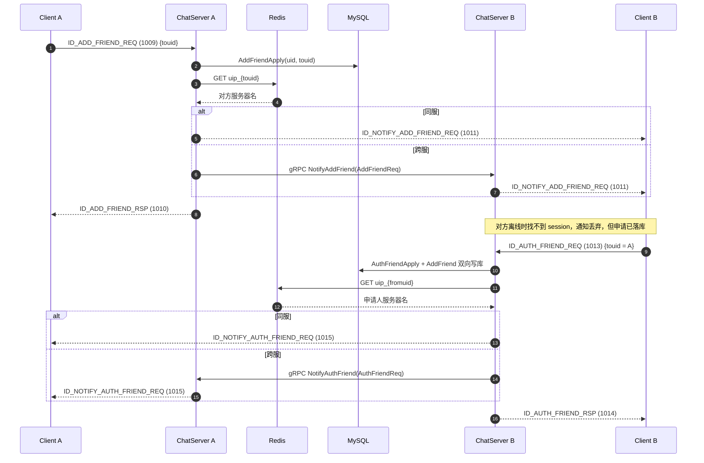

## 9. 登录 + 加好友全景（跨服）

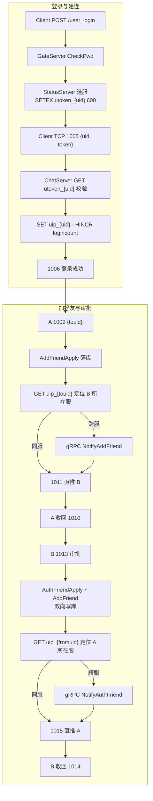

## 10. 会话生命周期

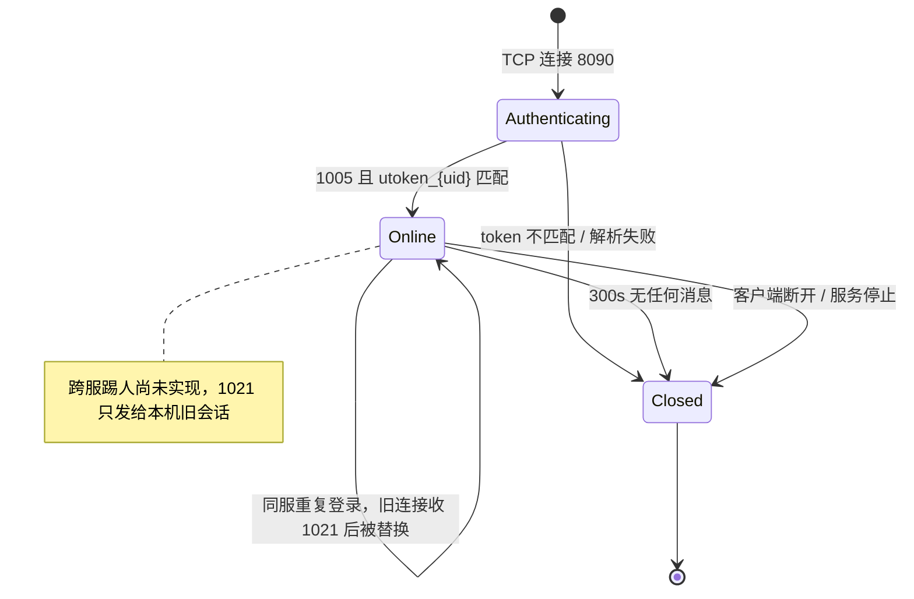

## 11. 分布式锁

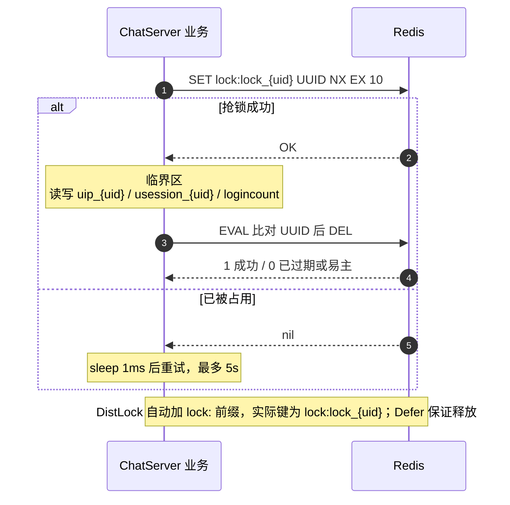

## 12. 聊天记录分页

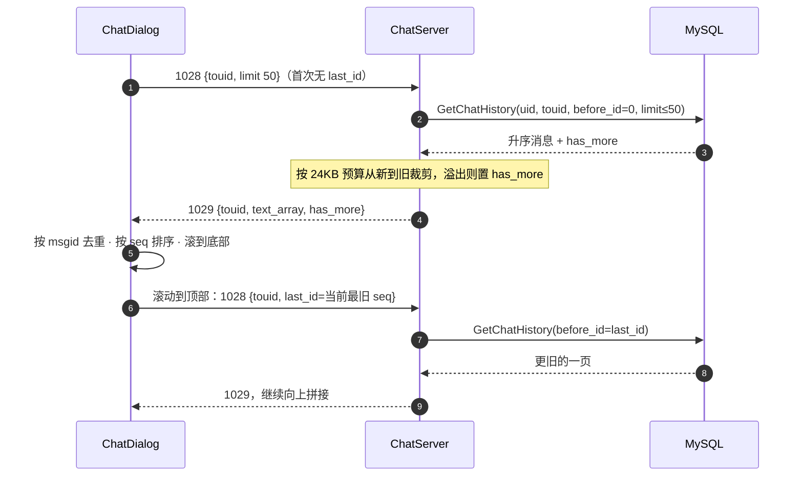

## 13. 文件分片转发

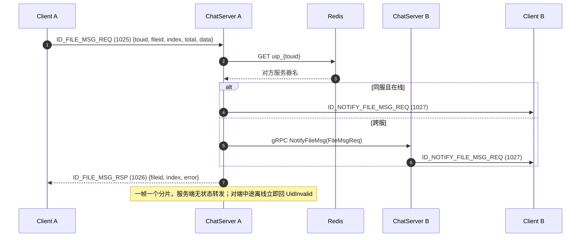

## 14. 客户端 TCP 帧与粘包处理

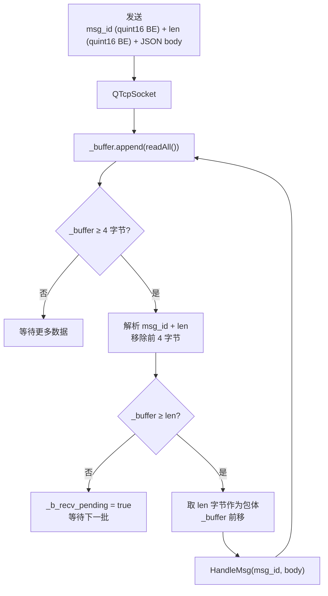

---

## 与旧 `.drawio` 的对应关系

| 原文件 | 本文件章节 |
|--------|-----------|
| `ChatClient/Client.drawio` | §5 客户端窗口流转 |
| `ChatClient/MsgBubble.drawio` | §6 消息气泡布局 |
| `GateServer/GateServer.drawio` | §2 GateServer |
| `StatusServer/StatusServer.drawio` | §3 StatusServer |
| `VerifyServer/VerifyServer.drawio` | §4 VerifyServer |
| `ChatServer/ChatServer.drawio` | §7 登录与建连 |
| `ChatServer/AddFriend.drawio` | §8 加好友与通过验证 |
| `ChatServer/LoginAndAddFriend.drawio` | §9 登录 + 加好友全景 |

新增图：§10 会话生命周期、§11 分布式锁、§12 聊天记录分页、§13 文件分片转发、§14 客户端 TCP 帧与粘包处理。
